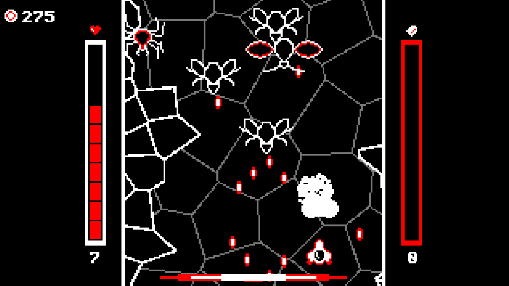

# Instar

Instar is a pixel shoot 'em up built in Unity in which enemies, waves and environments are generated entirely procedurally. This project was produced for the [BSc Computer Science thesis](https://eryngia.github.io/files/bsc_thesis_computer_science_report.pdf) of Barnabas Tanczos at the University of St Andrews.

## How to Play

Before playing, you can view the controls and credits in the menu. There is also the option to choose one of ten colour schemes. The game itself consists of a series of levels in which you must navigate the environment and defeat enemies until you reach the end. You have a limited number of health and ammunition, as shown by the bars on the left and right, respectively. Being hit by a projectile or crashing into the environment or an enemy causes you to lose health. Once your health reaches zero, the game is over. Try to get the highest total score that you can.

You can defeat enemies by firing at them, which uses one ammunition per attack, or using a special attack, which consumes all remaining ammunition. Use the dash to reload and dodge projectiles. Defeating enemies earns you score. By defeating enemies quickly in succession, you build up to a streak, as seen in the bar on the bottom of the screen. Once the streak is activated, you gain a boost of power and gain a multiplier to your score. Keep defeating enemies to maintain the streak.

Between levels, you can choose one of three powers to augment your attacks or give you a passive benefit. Additionally, you can spend score to heal, or gain more maximum health and ammunition.

## Controls
- **Arrow Keys** - move / navigate (menu)
- **C** - regular attack / select (menu)
- **X** - special attack
- **Z** - dash
- **Esc** - pause
